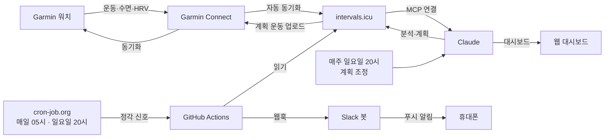

# 서브5 마라톤 AI 코치

> Claude + intervals.icu + Garmin으로 만든 **나만의 마라톤 코치**
> 데이터 분석 → 15주 훈련 계획 → 워치 전송 → 매주 자동 조정 → 매일 아침 Slack 알림까지, 대화만으로 설정했습니다.

풀코스 5시간 이내(평균 7:06/km)를 목표로, 무릎·족저근막염 이력이 있는 러너가 Claude에게 말로 요청해서 만든 훈련 시스템입니다. 코드를 직접 짜지 않고, Claude 데스크톱 앱의 대화창에서 모든 것을 설정했습니다.

---

## 무엇을 하나요



| 단계 | 하는 일 |
|---|---|
| 1. 수집 | Garmin 워치의 운동·HRV·수면·안정시 심박이 intervals.icu로 자동으로 모입니다. |
| 2. 분석 | Claude가 intervals.icu 데이터를 읽어 체력(CTL)·피로(ATL)·폼(TSB), 부하 균형(ACWR·단조도), 회복 상태, 부상 위험을 평가합니다. |
| 3. 계획 | 목표·가능한 요일·부상 이력에 맞춰 레이스 날까지 15주 계획을 세웁니다. |
| 4. 전송 | 러닝 운동을 intervals.icu 운동 문법(단계별)으로 캘린더에 넣으면, Garmin 워치에서 단계별 안내를 받을 수 있습니다. |
| 5. 시각화 | 분석 결과와 계획을 한눈에 보는 웹 대시보드를 만듭니다. |
| 6. 자동 조정 | 매주 일요일 저녁, 지난주 실제 데이터를 보고 다음 주 계획을 줄이거나 그대로 둡니다. |
| 7. 알림 | 매일 아침 "오늘 뛰어도 되는지"와 일요일 주간 리포트가 Slack 봇으로 휴대폰에 옵니다. 맥이 꺼져 있어도 GitHub Actions에서 실행되고, cron-job.org가 정각에 실행 신호를 보냅니다. |

---

## 준비물

| 항목 | 용도 | 비용 |
|---|---|---|
| Garmin 워치 + Garmin Connect | 운동·수면·HRV 기록, 계획 운동 실행 | 기기 보유 |
| [intervals.icu](https://intervals.icu) 계정 | 데이터 저장, 부하 계산, 캘린더 | 무료(후원 선택) |
| Claude 데스크톱 앱 (Code 탭) | 대화로 분석·계획·설정 | Claude 구독 |
| intervals.icu MCP 서버 | Claude가 intervals.icu를 읽고 쓰게 해 주는 연결 도구 | 무료(커뮤니티) |
| (선택) Claude in Chrome | Garmin Connect 화면 확인용 | 무료 |
| Slack + Slack 앱(Incoming Webhook) | 휴대폰 알림 | 무료 |
| GitHub 비공개 저장소 + Actions | 맥 없이 알림 실행 | 무료 사용량 안 |
| [cron-job.org](https://cron-job.org) | 정각에 GitHub 실행 신호 보내기 | 무료 |

---

## 설정 순서

### 1. Garmin ↔ intervals.icu 연결

1. intervals.icu에 가입하고 **Settings**에서 Garmin Connect를 연결합니다.
2. 운동 기록과 웰니스(수면·HRV·안정시 심박) 가져오기를 켭니다.
3. **계획 운동을 Garmin으로 업로드**하는 옵션을 켭니다. 이게 켜져 있어야 캘린더 운동이 워치로 넘어갑니다.
4. **Settings → 스포츠 설정**에서 러닝(Run)의 역치 심박(LTHR)과 최대 심박을 확인합니다. 심박 존과 부하 계산이 이 값을 기준으로 합니다.

### 2. intervals.icu MCP 서버를 Claude에 연결

1. intervals.icu **Settings → Developer Settings**에서 API 키를 발급받습니다. 선수 ID(`i` + 숫자)도 확인해 둡니다.
2. 사용하는 intervals.icu MCP 서버의 안내에 따라 Claude 설정에 추가합니다. 형태는 대략 이렇습니다.

```json
{
  "mcpServers": {
    "intervals-icu": {
      "command": "<MCP 서버 실행 명령>",
      "env": {
        "INTERVALS_API_KEY": "<내 API 키>",
        "INTERVALS_ATHLETE_ID": "<내 선수 ID>"
      }
    }
  }
}
```

> ⚠️ API 키는 절대 GitHub에 올리지 마세요. 위 값은 자리표시자입니다.

3. Claude에게 `intervals.icu에서 최근 운동 5개 보여줘`라고 물어서 연결을 확인합니다.

### 3. 대화로 설정하기

아래 순서대로 Claude에게 요청했습니다. 실제로 쓴 프롬프트는 [PROMPTS.md](PROMPTS.md)에 있습니다.

| # | 요청 | 결과 |
|---|---|---|
| 1 | 최근 운동과 어젯밤 HRV 보기 | 연결 확인 |
| 2 | 최근 6주 데이터 점검 | 운동 수, HRV·수면·안정시 심박이 있는 날 수, CTL/ATL/TSB, **비어 있거나 이상한 데이터 목록** |
| 3 | 내 정보 + 7일 계획 요청 | 부하 균형, 회복 상태, 부상 위험, 훈련 부족/과다 판정, 요일별 계획과 이유 |
| 4 | 계획 수정 (월요일은 러닝) | 요일 재배치 |
| 5 | 대시보드 만들기 | 추이·주간 부하·HRV·계획 표가 있는 웹 페이지 |
| 6 | 캘린더 등록 (워치용 단계 문법) | intervals.icu 캘린더에 계획 운동 등록 |
| 7 | 레이스 날까지 전체 계획 | 15주 계획 등록 + 레이스 이벤트 |
| 8 | Garmin으로 넘어갔는지 확인 | Garmin Connect 캘린더에서 확인 |
| 9 | 매주 자동 점검 | 일요일 20시 예약 작업 |
| 10 | Slack 알림 | Slack 앱(봇) + 웹훅으로 아침 준비도·주간 리포트 |
| 11 | 맥 없이 돌리기 | GitHub Actions(비공개 저장소)로 알림 이전 |
| 12 | GitHub에 정리 | 이 저장소 |
| 13 | 알림 시간 맞추기 | GitHub 예약이 몇 시간씩 늦어서 cron-job.org로 정각 실행 |

---

## 분석에 쓴 지표

| 지표 | 뜻 | 보는 법 |
|---|---|---|
| **CTL** (체력) | 최근 42일 훈련 부하의 가중 평균 | 천천히 올라가야 좋음. 주당 +1~3 정도가 안전 |
| **ATL** (피로) | 최근 7일 훈련 부하의 가중 평균 | CTL보다 크게 높으면 피로 누적 |
| **TSB** (폼) | CTL − ATL | 플러스면 쉬어서 가벼움, −30 아래면 과부하 |
| **ACWR** | 최근 7일 부하 ÷ 최근 28일 주평균 | 0.8~1.3 적정, 1.5 초과면 부상 위험 증가 |
| **주간 증가율** | 이번 주 부하 ÷ 지난주 부하 | 쌓는 주 기준 +10~15% 이내 |
| **단조도** | 7일 일평균 부하 ÷ 일별 표준편차 | 2.0 넘으면 매일 비슷하게 해서 위험 |
| **HRV** (rMSSD) | 자율신경 회복 지표 | **내 평소 값 대비** 7일 평균이 10% 이상 낮으면 회복 부족 |
| **안정시 심박** | 아침 심박 | 평소보다 3bpm 이상 높으면 피로·스트레스 신호 |

> 💡 처음 분석에서 가장 큰 위험 요인은 훈련이 아니라 **수면 부족**이었습니다. 운동량이 적은 주에도 HRV가 떨어지고 안정시 심박이 올라갔습니다.

---

## 15주 계획 구조

**주간 기본 틀** (러닝이 이틀 연속인 날이 없도록 배치)

| 월 | 화 | 수 | 목 | 금 | 토 | 일 |
|---|---|---|---|---|---|---|
| 쉬운 러닝 + 가속주 | 근력 A (하체·코어·재활) | 휴식 / 크로스 트레이닝 | 핵심 세션 (마라톤 페이스·템포) | 근력 B (상체·코어·종아리) | 롱런 | 휴식 |

**주차별 흐름** (3주 쌓고 1주 회복)

| 주 | 단계 | 목요일 핵심 세션 | 토요일 롱런 |
|---|---|---|---|
| 1 | 리듬 회복 | 마라톤 페이스 2×8분 | 10km |
| 2 | 쌓기 | 마라톤 페이스 3×8분 | 12km |
| 3 | 쌓기 | 마라톤 페이스 3×10분 | 14km |
| 4 | **회복 주** | 마라톤 페이스 2×10분 | 10km |
| 5 | 쌓기 (+수요일 크로스) | 마라톤 페이스 2×15분 | 15km |
| 6 | 쌓기 | 템포 4×6분 | 17km |
| 7 | **회복 주** | 마라톤 페이스 20분 | 12km |
| 8 | 쌓기 | 마라톤 페이스 25분 | 19km |
| 9 | 쌓기 | 템포 5×5분 | 21km (마지막 3km 목표 페이스) |
| 10 | **회복 주** | 마라톤 페이스 20분 | 14km |
| 11 | 쌓기 | 마라톤 페이스 30분 | 24km (마지막 4km 목표 페이스) |
| 12 | **정점** | 마라톤 페이스 2×20분 | 27km (최장거리) |
| 13 | 테이퍼 1 | 마라톤 페이스 30분 | 20km 레이스 리허설 |
| 14 | 테이퍼 2 | 마라톤 페이스 2×10분 | 14km |
| 15 | 레이스 주 | 마라톤 페이스 3×5분 | 레이스 전날 20분 → **일요일 풀코스** |

**설계 원칙**
- 롱런은 한 번에 2km 안팎씩만 늘립니다.
- 최장 롱런은 27km입니다. 5시간 목표에는 32km까지 가는 것보다 부상 위험이 낮습니다.
- 수요일 크로스 트레이닝(실내 자전거·일립티컬)으로 충격 없이 유산소를 늘립니다.
- 근력 운동은 테이퍼에 들어가면 2세트, 마지막 2주는 코어·가동성만 합니다.
- 운동마다 그날 판단 기준을 적어 둡니다. 예: "HRV 38 이하·안정시 심박 58 이상·수면 5시간 미만이면 쉬운 러닝으로 대체". 기준 숫자는 각자 평소 값에 맞춰 바꾸세요.

---

## 워치로 보내는 운동 문법

intervals.icu 캘린더 운동의 설명란에 아래 형식으로 쓰면 단계가 나뉜 운동으로 인식되어 Garmin 워치에 전송됩니다.

```text
Warmup
- 15m 120-140bpm

Main 2x
- 8m 7:00-7:10/km pace
- 2m 120-135bpm

Cooldown
- 10m 115-135bpm
```

자세한 규칙과 실제로 부딪힌 문제는 [WORKOUT_SYNTAX.md](WORKOUT_SYNTAX.md)에 정리했습니다.

---

## 자동화 구성

| 하는 일 | 시간 (한국) | 어디서 | 맥 필요 |
|---|---|---|---|
| ☀️ 아침 준비도 알림 | 매일 05:00 | cron-job.org → GitHub Actions → Slack 봇 | ❌ |
| 📋 주간 리포트 | 일요일 20:00 | cron-job.org → GitHub Actions → Slack 봇 | ❌ |
| 🛠 다음 주 계획 조정 | 일요일 20:00 | 맥의 Claude 예약 작업 | ⭕ (꺼져 있으면 켤 때 실행) |
| 계획 운동 → 워치 | 수시 | intervals.icu → Garmin | ❌ |

알림 봇 설정 방법, 판단 규칙, 부딪힌 문제는 [SLACK_BOT.md](SLACK_BOT.md)에 정리했습니다.

### 매일 할 일 (사람)

1. 일어나면 **Garmin Connect 앱을 열어 동기화**합니다. 지난밤 HRV·수면이 넘어가야 정확합니다.
2. **Slack 알림**을 확인합니다. ✅면 워치 운동 그대로, 🟡🔴면 알림대로 강도를 낮춥니다(워치 운동은 자동으로 바뀌지 않음).
3. 운동은 워치로 기록합니다.
4. **통증이 있으면 Claude에게 직접 말합니다.** 데이터로는 알 수 없습니다.

## 매주 계획 조정 (맥의 Claude)

Claude 데스크톱 앱의 **예약 작업(Scheduled)** 기능으로 매주 일요일 20시에 실행합니다. 실제로 운동을 바꿨을 때만 Slack에 짧게 알립니다.

1. 지난 7일 운동, 42일 웰니스, 다음 주 계획을 읽습니다.
2. 경고 신호를 셉니다.
   - HRV 7일 평균이 42일 평균보다 10% 이상 낮음
   - 안정시 심박이 3bpm 이상 높음
   - 수면 평균 5시간 미만
   - ACWR 1.5 초과
   - 실제 부하가 계획보다 25% 이상 많음
3. 다음 주만 조정합니다.
   - 경고 2개 이상이면 핵심 세션을 쉬운 러닝으로 바꾸고 롱런을 20% 줄입니다.
   - 경고 1개면 조금 줄입니다.
   - **늘리는 조정은 하지 않습니다.**
4. 바꾼 운동은 이름 앞에 "(조정)"을 붙이고 설명 첫 줄에 이유를 적습니다. 대시보드 데이터도 갱신합니다.

예: 첫 주 점검에서 수면 부족 경고로 목요일 마라톤 페이스 2×8분 → 1×8분, 토요일 롱런 10km → 9km로 줄었습니다.

전체 예약 작업 프롬프트는 [PROMPTS.md](PROMPTS.md#9-매주-자동-점검-예약-작업)에 있습니다.

> 예약 작업은 Claude 앱이 켜져 있을 때 실행됩니다. 앱이 꺼져 있으면 다음에 열 때 실행됩니다. 월요일 아침 운동 전에 맥을 한 번 켜면 조정이 반영됩니다.

---

## 실제로 부딪힌 문제와 해결

| 문제 | 원인 | 해결 |
|---|---|---|
| 하루만 조회한 CTL이 2.0, 기간 조회는 13.2 | 처음 조회 때 재계산 전 값이 나옴 | 다시 조회하니 일치. **숫자가 이상하면 다른 방법으로 한 번 더 조회** |
| 웰니스에 모든 날이 "Ride"로 표시 | 사이클 파워 추정치 항목이었음 | 운동 종목 문제가 아니었음. 수정 불필요 |
| 심박 목표 러닝의 부하가 0 | 심박 목표만으로는 부하가 계산되지 않음 | `training_load`를 직접 입력 |
| 거리 단계 롱런의 예상 시간이 너무 짧게 표시 | intervals.icu가 자체 페이스로 추정 | 표시만 다름. 실제 운동에는 영향 없음 |
| 근력 운동이 워치에서 단계 없이 표시 | 운동 문법이 근력 세트를 지원하지 않음 | 설명에 운동 목록을 텍스트로 적음 |
| Garmin에 이번 주 운동만 보임 | 가까운 며칠 치만 업로드됨 | 정상. 날짜가 다가오면 순서대로 넘어감 |
| Garmin엔 있는데 intervals.icu엔 없는 운동 | 동기화 지연 | 분석 전에 동기화 여부 확인 |
| 대시보드 숫자가 자동 갱신 안 됨 | MCP 연결이 내 컴퓨터의 Claude에만 있음 | 주간 자동 점검에서 데이터 파일 교체 |
| Slack DM은 왔는데 알림이 안 울림 | Claude의 Slack 연결은 내 계정으로 보냄 → 나에게 보낸 메시지 | Slack 앱(봇) 웹훅으로 보내기 |
| 맥이 꺼져 있으면 알림이 안 옴 | 예약 작업이 맥의 Claude 앱 안에서 돔 | 알림은 GitHub Actions로 이전 |
| GitHub Actions에서 intervals.icu `403` | 요청에 User-Agent가 없어 차단 | User-Agent 헤더 추가 |
| 05:00 알림이 08:38, 11:41에 옴 | GitHub 자체 예약은 몇 시간씩 늦게 실행될 수 있음 | cron-job.org가 정각에 실행 신호 |

---

## 파일 구성

| 파일 | 내용 |
|---|---|
| [README.md](README.md) | 전체 개요 (이 문서) |
| [PROMPTS.md](PROMPTS.md) | 실제로 쓴 프롬프트 모음. 복사해서 바로 쓸 수 있게 정리 |
| [WORKOUT_SYNTAX.md](WORKOUT_SYNTAX.md) | intervals.icu 운동 문법과 운동 템플릿 |
| [SLACK_BOT.md](SLACK_BOT.md) | Slack 봇 만들기, GitHub Actions로 맥 없이 알림 보내기, cron-job.org로 정각 실행 |
| [bot/](bot/) | 알림 봇 코드(`coach.py`)와 GitHub Actions 설정(`coach.yml`). 비밀 값 없음 |
| [REELS_SCRIPT.md](REELS_SCRIPT.md) | 인스타그램 릴스용 60초 대본과 촬영 목록 |

---

## 주의

- 이 저장소의 내용은 **의학적 조언이 아닙니다.** 부상 이력이 있다면 의사나 물리치료사와 상의하세요.
- 계획의 페이스·심박 숫자는 한 러너의 기준입니다. 본인의 역치 심박과 최근 기록에 맞춰 바꾸세요.
- 통증은 데이터로 알 수 없습니다. 아침 첫걸음 뒤꿈치 통증이나 10점 중 3점 이상의 무릎 통증이 있으면 러닝을 멈추세요.
- GitHub에 올리기 전에 API 키, 선수 ID, 이메일, 대시보드 링크, Slack 웹훅 주소 같은 개인 정보가 없는지 확인하세요. 비밀 값은 GitHub Secrets에만 넣습니다.
