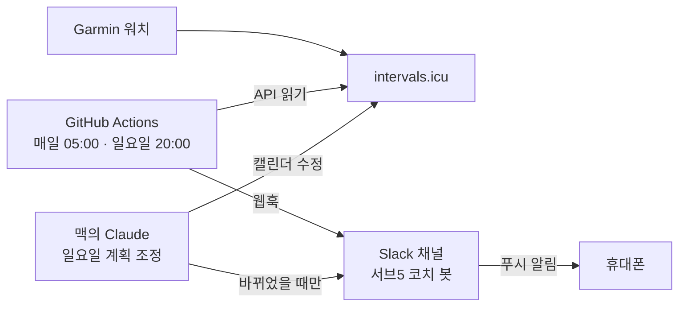

# Slack 알림 봇 + 클라우드 자동 실행

매일 아침 "오늘 뛰어도 되는지"와 매주 일요일 리포트를 **휴대폰 Slack 알림**으로 받는 방법입니다. 맥이 꺼져 있어도 동작하도록 **GitHub Actions**(GitHub의 무료 클라우드 실행)에서 돌립니다.



| 알림 | 시간 (한국) | 어디서 | 내용 |
|---|---|---|---|
| ☀️ 아침 준비도 | 매일 05:00 전후 | GitHub Actions | 오늘 운동, HRV·안정시 심박·수면 vs 평소, 판단과 오늘 할 일 |
| 📋 주간 리포트 | 일요일 20:00 전후 | GitHub Actions | 지난주 완료·부하·ACWR, 회복 지표, 경고, 다음 주 계획 |
| 🛠 계획 조정 알림 | 일요일 20:00 (맥을 켤 때) | 맥의 Claude | 다음 주 운동을 실제로 바꿨을 때만 |

---

## 왜 이렇게 나눴나

| 처음 시도 | 문제 | 바꾼 방법 |
|---|---|---|
| Claude의 Slack 연결로 내 DM에 보내기 | **내 계정이 나에게 보내는 메시지라 푸시 알림이 안 울림** | Slack 앱(봇)의 Incoming Webhook으로 보내기 |
| 맥의 Claude 예약 작업으로 매일 알림 | **맥이 꺼져 있으면 실행 안 됨** (켤 때 늦게 실행) | GitHub Actions에서 실행 |
| 계획 조정까지 클라우드로 | 규칙만으로 캘린더를 고치는 건 위험 | 조정은 맥의 Claude가 맥락을 보고 하도록 유지 |

아침 판단은 규칙이 정해져 있어서 AI 없이 코드만으로 충분합니다. 그래서 클라우드 쪽에는 Claude API 비용이 들지 않습니다.

---

## 1. Slack 앱(봇) 만들기

1. https://api.slack.com/apps → **Create New App** → **From scratch** 아래 **Paste a manifest** → **Continue**
2. 워크스페이스를 고르고 **JSON** 탭에 아래 내용을 붙여 넣습니다.

```json
{
  "display_information": {
    "name": "서브5 코치",
    "description": "마라톤 훈련 아침 준비도와 주간 리포트 알림"
  },
  "features": {
    "bot_user": {
      "display_name": "sub5-coach",
      "always_online": false
    }
  },
  "oauth_config": {
    "scopes": {
      "bot": ["incoming-webhook"]
    }
  },
  "settings": {
    "org_deploy_enabled": false,
    "socket_mode_enabled": false,
    "token_rotation_enabled": false
  }
}
```

> 부딪힌 오류 두 가지
> - `incoming-webhook` 줄에 오류 → `features.bot_user`가 없어서. 봇 권한을 쓰려면 봇 설정이 함께 있어야 합니다.
> - `display_name` 줄에 오류 → **봇 표시 이름은 영문 소문자·숫자·`-_.`만** 됩니다. 앱 이름(`name`)은 한글이어도 됩니다.

3. **Next → Create**
4. 앱 설정 왼쪽 **Incoming Webhooks** → 스위치 **On** → **Add New Webhook** → 채널 선택(예: `#서브5-코치`) → **허용**
5. 생긴 `https://hooks.slack.com/services/...` 주소를 **Copy**

⚠️ 웹훅 주소는 비밀번호처럼 다루세요. 있으면 누구나 그 채널에 글을 올릴 수 있습니다. 채팅, GitHub, 스크린샷에 노출하지 마세요.

**휴대폰 알림이 안 울리면:** Slack 앱에서 그 채널 → 채널 이름 → 알림 → **모든 새 메시지**.

---

## 2. GitHub 비공개 저장소 만들기

알림 봇은 **설명서 저장소와 분리된 비공개 저장소**에 둡니다.

- 공개 저장소의 예약 실행은 **60일 동안 활동이 없으면 GitHub가 자동으로 멈춥니다.** 레이스까지 15주라 비공개가 안전합니다.
- 실행 기록(로그)에 HRV·수면 같은 건강 데이터가 찍힙니다.

이 저장소의 [`bot/`](bot/) 폴더에 있는 두 파일을 새 비공개 저장소에 이렇게 넣습니다.

```text
sub5-coach-bot/
├── coach.py                    ← bot/coach.py
└── .github/workflows/coach.yml ← bot/coach.yml
```

GitHub CLI(`gh`)로 하면 이렇습니다. 없으면 `brew install gh` 후 `gh auth login`.

```bash
gh repo create sub5-coach-bot --private --source . --remote origin --push
```

---

## 3. Secrets 넣기

비밀 값은 코드가 아니라 **GitHub Secrets**(암호화 저장)에 넣습니다. 각 명령을 실행하면 값을 붙여 넣으라는 입력창이 나오고, 입력 내용은 화면에 보이지 않습니다.

```bash
gh secret set INTERVALS_API_KEY -R <내 GitHub ID>/sub5-coach-bot
```

```bash
gh secret set INTERVALS_ATHLETE_ID -R <내 GitHub ID>/sub5-coach-bot
```

```bash
gh secret set SLACK_WEBHOOK_URL -R <내 GitHub ID>/sub5-coach-bot
```

| 이름 | 값 |
|---|---|
| `INTERVALS_API_KEY` | intervals.icu → Settings → Developer Settings의 API 키 |
| `INTERVALS_ATHLETE_ID` | intervals.icu 선수 ID (`i`로 시작). 비우면 본인 |
| `SLACK_WEBHOOK_URL` | 1단계에서 복사한 웹훅 주소 |

> 💡 클립보드에서 바로 넣으려다 **명령어를 복사하는 순간 웹훅 주소가 클립보드에서 지워져** 명령어 문장이 저장된 적이 있습니다. 명령을 먼저 터미널에 붙여 넣고, 그다음 주소를 복사하고, 마지막에 Enter를 누르세요.

---

## 4. 테스트

GitHub 저장소 → **Actions** → "서브5 코치 알림" → **Run workflow** → `morning` 또는 `weekly`.

```bash
gh workflow run coach.yml -R <내 GitHub ID>/sub5-coach-bot -f mode=morning
```

Slack에 "서브5 코치" 이름으로 메시지가 오면 성공입니다.

---

## 아침 준비도 판단 규칙

| 경고 신호 | 기준 |
|---|---|
| HRV 낮음 | 오늘 HRV가 42일 평균보다 15% 이상 낮음 |
| 안정시 심박 높음 | 42일 평균보다 4bpm 이상 높음 |
| 수면 부족 | 지난밤 5시간 미만 |
| 계획 외 운동 | 어제 실제 부하가 계획보다 40 이상 많음 |

| 경고 수 | 표시 | 오늘 할 일 (예: 마라톤 페이스 세션 날) |
|---|---|---|
| 0 | ✅ | 계획대로, 심박 155 이하 |
| 1 | 🟡 | 쉬운 러닝 30분(125-140bpm)으로 바꾸기 |
| 2 이상 | 🔴 | 걷기 30분이나 휴식 |
| 휴식일 | 🛌 | 푹 쉬기 |
| 오늘 데이터 없음 | ⏳ | Garmin Connect 앱을 열어 동기화한 뒤 확인 |

아침 알림은 **조언만** 하고 워치 운동은 바꾸지 않습니다. 🟡🔴일 때는 워치에서 계획 운동 대신 일반 달리기로 시작해 심박만 지키면 됩니다.

---

## 실제로 부딪힌 문제

| 증상 | 원인 | 해결 |
|---|---|---|
| Slack DM이 왔는데 알림이 없음 | 내 계정이 나에게 보낸 메시지 | 봇(웹훅)으로 보내기 |
| 맥에서 웹훅 전송 시 `CERTIFICATE_VERIFY_FAILED` | python.org에서 설치한 Python에 인증서 목록이 없음 | macOS 시스템 인증서(`/etc/ssl/cert.pem`) 사용 |
| GitHub Actions에서 intervals.icu `403 Forbidden` | 요청에 프로그램 이름(User-Agent)이 없어 보안 장치가 차단 | `User-Agent` 헤더 추가 (`bot/coach.py`에 반영됨) |
| 키를 넣기 전 실행에서도 `403` | Secret이 비어 있음 | `gh secret list`로 3개가 다 있는지 확인 |
| 알림이 05:00보다 늦게 옴 | GitHub 예약 실행은 몇 분~수십 분 늦을 수 있음 | 정상. 지난밤 데이터 동기화 시간을 버는 효과도 있음 |
| 새벽 5시에 HRV가 비어 있음 | 워치가 아직 휴대폰과 동기화 안 됨 | ⏳ 안내가 오면 Garmin Connect 앱을 열어 동기화 |
